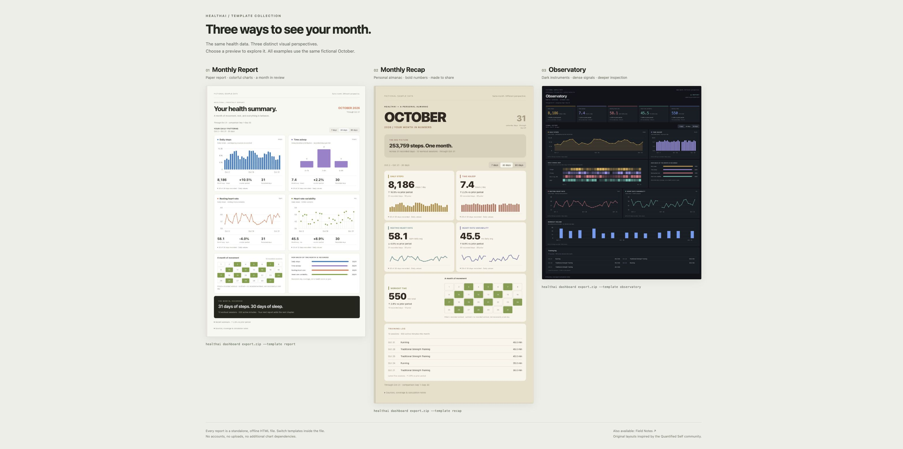
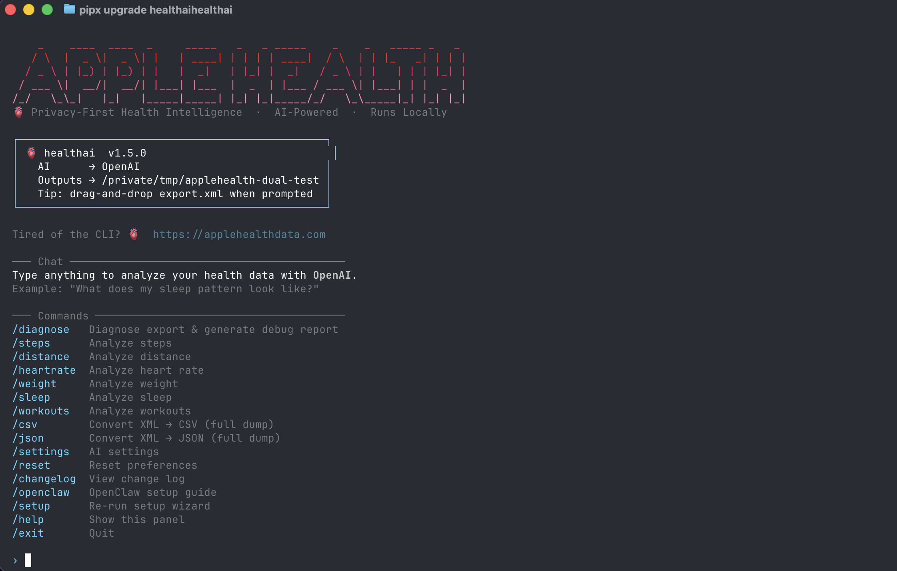

# 🫀 healthai — Private Apple Health Export & Analysis

**Turn your Apple Health export into a private dashboard, usable CSV/JSON, or an optional AI conversation. Your dashboard runs offline in a single HTML file.**

[](https://github.com/krumjahn/applehealth/stargazers)
[](LICENSE)
[](https://www.python.org/downloads/)
[](https://pypi.org/project/healthai/)
[](https://ollama.com/library/deepseek-r1)
[](https://clawhub.ai/krumjahn/apple-health-export-analyzer)

## Your health, in perspective



**New in v1.12.0:** a local dashboard for steps, sleep, resting heart rate, HRV, and workouts. No account, AI setup, server, or chart CDN. [Install the release](https://github.com/krumjahn/applehealth/releases/tag/v1.12.0) or try the source demo below.

**One export, three distinct perspectives.** Choose a layout, then switch templates inside the generated HTML without parsing your export again. Every layout uses the same measurements and calculation policy.

| Template | Visual direction | Try it |
|---|---|---|
| **Monthly Report** | Compact paper report, sleep distribution, daily charts, workout calendar, and coverage strips | `./run dashboard --demo --template report --out report.html --open` |
| **Monthly Recap** | Warm portrait almanac, oversized numbers, small trend charts, and a monthly steps headline | `./run dashboard --demo --template recap --out recap.html --open` |
| **Observatory** | Dense dark panels, precise axes, daily signal heatmap, and workout volume | `./run dashboard --demo --template observatory --out observatory.html --open` |

[Download the template gallery](https://github.com/krumjahn/applehealth/releases/download/v1.12.0/healthai-dashboard-templates.zip), unzip it, and open `dashboard-templates.html` to explore all layouts. The original editorial **Field Notes** layout also remains available with `--template field-notes`. `report` is the default. The in-file picker changes the current view; use the CLI option to set the layout shown when the file opens.

These original layouts take visual cues from the community's [monthly health report](https://www.reddit.com/r/QuantifiedSelf/comments/1vobemm/june_july_health_tracked_v2_update/), [October recap](https://www.reddit.com/r/QuantifiedSelf/comments/1xq3h2j/my_october2026_quantifiedself/), and [self-hosted monitoring dashboard](https://www.reddit.com/r/QuantifiedSelf/comments/1xek5mw/my_selfhosted_setup_a_year_of_data_80_metrics_in/). Their screenshots, personal data, proprietary scores, and unsupported metrics are not bundled. Observatory's heatmap shows daily summaries, with each metric independently scaled; it does not imply hourly samples or cross-metric comparability.

Try the fictional demo before exporting any health data:

```bash
git clone https://github.com/krumjahn/applehealth.git
cd applehealth
./run dashboard --demo --open
```

The demo needs only Python 3.9+ and the source checkout. You can also download [the standalone demo HTML](https://github.com/krumjahn/applehealth/releases/download/v1.12.0/dashboard-demo.html) and open it locally.

For your own data, install this checkout in a virtual environment once, then generate a report:

```bash
python3 -m venv .venv
.venv/bin/python -m pip install -e .
./run dashboard ~/Downloads/export.zip --out ./my-health.html --open
```

With v1.12.0 or this checkout installed, `healthai dashboard` is equivalent to `./run dashboard`. XML files and export directories work too. To export from your iPhone, open **Health → your profile → Export All Health Data**, then transfer the ZIP to your computer.

```bash
# Choose a month instead of the latest month found in your export
healthai dashboard export.xml --month 2026-10 --template recap --out october.html

# Include only named sources (repeat --source to include more than one)
healthai dashboard export.zip --source "Keith's Apple Watch" --out watch.html
```

- **Monthly overview:** daily means and recorded-day counts, compared with the same elapsed days in the previous month. Workout minutes are a total.
- **Interactive trends:** switch between 7, 30, and 90 days, inspect chart values, or expand accessible daily tables. Missing measurements remain gaps.
- **Portable output:** one HTML file with all data and styles embedded. Open it offline or use **Print / Save PDF** in your browser. Each run requires a new output filename.
- **Transparent calculations:** the existing analyzer reconciles overlapping step/sleep sources. HRV is normalized to milliseconds; resting heart rate to BPM. Workouts use valid active duration, falling back to elapsed time with a warning. Exact matching workout intervals and activity types are counted once.

The report is a **snapshot**, not a live sync service. Regenerate it from a newer export to refresh it. Its 90-day window ends at the last supported record in the selected month. XML/ZIP is scanned twice, retaining only supported records in that window for analysis; memory and processing time still depend on the number of retained samples. This differs from the streaming raw converter's memory characteristics below. Real-data dashboards require pandas, already a project dependency; no AI provider is invoked. Dashboard source selection is explicit via `--source` and does not read saved interactive preferences.

**Privacy:** dashboard generation makes no network requests. The HTML contains your health summaries and source names; anyone you give it to can read those values. Only fictional data is included in the checked-in demo and screenshot. Installation may download dependencies; optional cloud AI is a separate command path.

## Export your data locally

The new `convert` command runs without AI setup, API keys, uploads, telemetry, or third-party Python packages. From this source checkout:

```bash
./run convert ~/Downloads/export.zip --format both --out ./my-health-export
```

It also accepts `export.xml` or a directory containing it. With this checkout installed, the equivalent is:

```bash
healthai convert ~/Downloads/export.zip --format both --out ./my-health-export
```

**New in v1.11.0.** Install the [latest GitHub release](https://github.com/krumjahn/applehealth/releases/latest) or use `./run convert` from source. PyPI installations may lag behind this release.

Choose `--format csv` (the default), `json`, or `both`. Use a **new output directory** for each run. Progress is shown locally; `--quiet` hides progress while retaining the completion summary and warnings.

| Output | Contents |
|---|---|
| `records.csv` / `records.json` | Raw measurements with original units, values, dates and sources |
| `workouts.csv` / `workouts.json` | Workouts, nested statistics, events and route references |
| `activity_summary.csv` / `activity_summary.json` | Activity summary attributes |
| `export_report.json` | Local row counts, unsupported element counts, input XML checksum and conversion duration |

CSV flattens metadata into `metadata:<key>` columns. Nested elements are preserved in a `children` column containing JSON, including repeated metadata entries. JSON keeps a convenient `metadata` object and structured `children`. Referenced GPX/ECG files inside ZIPs are **not extracted**. Top-level `Me` and `ExportDate` metadata are omitted and counted in the report; other unsupported top-level elements produce a warning and counts.

Raw conversion does **not** change units, combine sources, deduplicate measurements, or calculate daily totals. For source-aware summaries and unit conversion, use the interactive analysis commands below. This keeps the original measurements available for your own processing.

The converter streams records instead of retaining the whole XML tree. JSON takes one pass; CSV takes two so columns discovered near the end are included. Memory depends on the largest individual record and the number of distinct columns, rather than total record count. Outputs are staged locally and published together only after success; malformed XML, changed input between CSV passes, and write errors fail explicitly. Existing output directories are refused.

**Privacy:** conversion makes no network requests and does not read or save AI preferences. The report stays in your output folder; nothing is sent to us. Downloading/installing software still requires network access. Optional cloud AI chat sends data to the provider you choose; local conversion never invokes it.

### Measured large-file behavior

Local synthetic CSV benchmark, November 2, 2026, on macOS arm64 / Python 3.14.6:

| Input | Previous raw CSV algorithm | Streaming converter |
|---|---|---|
| 10,000 rows / 2.38 MB XML | 0.21 s / 85.5 MiB peak memory | 0.08 s / 26.6 MiB |
| 100,000 rows / 23.8 MB XML | 0.64 s / 194.2 MiB | 0.68 s / 25.9 MiB |
| 1,000,000 rows / 238 MB XML | 5.86 s / 1,289.1 MiB | 6.90 s / 25.9 MiB |
| 10,000,000 rows / 2.38 GB XML | Not run | 68.11 s / 26.4 MiB |

The measured benefit is predictable memory use: about 50× less peak memory at one million rows. Two-pass CSV was slightly slower at that size; this is not a universal speedup claim. Each measurement is one run in a fresh process with warm filesystem cache, including imports. The previous-algorithm baseline retains the XML tree, row dictionaries and a pandas DataFrame; it excludes AI startup and processed summaries. Fixtures contain flat synthetic step records, so ZIP decompression and nested metadata will have different costs. Output counts and raw values are checked independently after conversion. No personal health data or usage analytics were collected.

Reproduce locally (the comparison requires pandas; the streaming-only run does not):

```bash
PYTHONPATH=src .venv/bin/python benchmarks/export_benchmark.py --records 10000 100000 1000000
PYTHONPATH=src python3 benchmarks/export_benchmark.py --records 10000000 --streaming-only
```

The large run temporarily needs several GB of free disk space. Generated inputs and outputs are removed afterwards. Machine-readable results: [comparison](benchmarks/export-results.json) and [large export](benchmarks/export-large-results.json). These are local benchmark results, not live tracking.

## Optional AI analysis



---

## Installation

Install v1.12.0 directly from the GitHub release:

```bash
pipx install https://github.com/krumjahn/applehealth/releases/download/v1.12.0/healthai-1.12.0-py3-none-any.whl
```

Already using pipx? Run the same release URL with `pipx install --force` to upgrade.

The installer and PyPI commands below install the version currently available on PyPI, which may be older.

```bash
curl -fsSL https://raw.githubusercontent.com/krumjahn/applehealth/main/install.sh | bash
```

Or install directly with pipx:

```bash
pipx install healthai
```

Then run:

```bash
healthai
```

On first launch, a setup wizard walks you through choosing your AI model (GPT-4o, Claude, Gemini, DeepSeek-R1, and 50+ more), setting your API key, and pointing to your `export.xml`. Re-run it any time with `healthai --setup`. The saved export path is reused by slash commands and chat.

### 🚀 **Prefer a GUI?**
Visit **[applehealthdata.com](https://applehealthdata.com)** for instant, interactive analysis without the terminal.

---

## 🧐 What is this?

A local Apple Health data toolkit: convert an XML/ZIP export into usable files, then explore trends with charts or optional AI chat. Conversion works entirely offline. Choose a local model for private AI analysis or explicitly configure a cloud provider.

It's built for developers, biohackers, and researchers who want **full control** over their health data pipeline.

## ✨ Key Features
- 🌿 **Offline health dashboard**: a monthly overview, 7/30/90-day trends, recent workouts, and a portable HTML report. Try `./run dashboard --demo --open` from this checkout.
- 📤 **Streaming raw export**: XML/ZIP → CSV/JSON, progress, preserved nested workout details, and a local completeness report. No AI setup needed.
- 💬 **Chat REPL**: Ask questions in plain English. `"What were my most active months last year?"` — chat builds query-aware local summaries and includes recent complete rows.
- 🧠 **50+ AI Models**: GPT-4o, Claude, Gemini, DeepSeek-R1, Grok, Mistral, Llama, and any Ollama local model.
- 🔒 **100% Private Mode**: Run DeepSeek-R1 or Llama 3 locally via Ollama — no data leaves your machine.
- 📊 **Automated Charts**: Daily heart-rate means, source-reconciled sleep patterns, and workout heart-rate intensity.
- 💍 **Smart Ring Integration**: Unified view of **Oura**, **Whoop**, and **Samsung Ring** data via Apple Health sync.
- 🔄 **WHOOP Integration**: Specialized support for augmenting Apple Health data with WHOOP metrics.

## 💬 Chat with Your Health Data

After setup, `healthai` drops you into a chat interface. Just type naturally:

```
  🫀 healthai  v1.5.0
  AI      → OpenAI (ChatGPT)
  Outputs → ~/healthai_output

  › What were my most active weeks last year?
  › How does my sleep correlate with my workout intensity?
  › Show me my heart rate trends over the past 3 months
```

Slash commands handle data operations:

| Command | Description |
|---|---|
| `/diagnose` | Audit metric calculations, units, sources, skipped records, and export types |
| `/steps` | Analyze step count trends |
| `/heartrate` | Daily average heart-rate trends |
| `/sleep` | Source-reconciled sleep duration and stage patterns |
| `/workouts` | Workout history with normalized distance, energy, and available heart-rate intensity |
| `/weight` | Body-mass trends normalized to kilograms |
| `/csv` | Export raw records plus processed metric CSVs used by chat |
| `/json` | Export all metrics to JSON |
| `/settings` | Change AI model, per-metric source priority, and maximum heart rate |
| `/setup` | Re-run the setup wizard |
| `/help` | Show all available commands |
| `/exit` | Quit |

## 🛠️ "Steal My System": From 8 Years of Data to Actionable Training
I used this exact tool to analyze 8 years of my own fitness history. Here's the system:
1. **The Pattern**: I discovered that my most active days (40k+ steps) almost never coincided with gym sessions—they were work-related.
2. **The Optimization**: I used the AI Analyzer to identify "Heart Rate Cycles" (3-4 week recovery dips) to automate my deload weeks.
3. **The Result**: A training plan that finally matches my biology instead of a generic app's schedule.
[Read the full case study here](https://rumjahn.com/how-i-used-a-i-to-analyze-8-years-of-apple-health-fitness-data-to-uncover-actionable-insights/).

## ⚡ Quick Start

**Recommended (install once, run anywhere):**
```bash
curl -fsSL https://raw.githubusercontent.com/krumjahn/applehealth/main/install.sh | bash
healthai
```

### Calculation policy

Apple Health exports can contain overlapping measurements from an iPhone, Apple Watch, and third-party devices. `healthai` now reconciles overlapping cumulative intervals instead of blindly adding every source. Its automatic order prefers manually entered Health data, then Apple Watch, then iPhone/iPad, then third-party sources. Because `export.xml` does not include the source order configured in the Health app, use `/settings` to set the exact priority for each metric when your preferred tracker differs.

All supported units are normalized before aggregation: distance to kilometers, body mass to kilograms, energy to kilocalories, and heart rate to BPM. Unsupported units are skipped and listed by `/diagnose`; they are never silently mislabeled.

**Imperial units (miles / pounds):** open `/settings` → *Choose units* and pick `imperial`. Charts, summaries, exported CSVs, and AI analyses then use miles and pounds instead of km and kg. You can also set `APPLEHEALTH_UNITS=imperial` in the environment.

**Source filter (e.g. only Apple Watch):** if a third-party app (Argus, Fitbit, etc.) pollutes your metrics, open `/settings` → *Configure data sources* and enter the sources to include — everything else is ignored entirely, no editing of `export.xml` required. Non-interactive equivalent: `APPLEHEALTH_SOURCES="Keith's Apple Watch"` (comma-separate multiple sources; names must match the sources listed in the settings screen).

**Or clone and run directly:**
```bash
git clone https://github.com/krumjahn/applehealth.git && cd applehealth
./run
```

**For private local AI (DeepSeek-R1, free, no API key):**
1. Install [Ollama](https://ollama.ai) and run `ollama pull deepseek-r1`.
2. Launch `healthai`, choose **Ollama** in the setup wizard.

---

## 🖥️ Local LLM Setup

Run any model 100% on your own machine — no API key, no data leaving your device.

### Ollama (easiest)

```bash
# 1. Install Ollama: https://ollama.ai
# 2. Pull a model
ollama pull llama3.1          # Meta Llama 3.1 8B
ollama pull deepseek-r1       # DeepSeek R1 reasoning
ollama pull mistral           # Mistral 7B
ollama pull qwen3             # Qwen3

# 3. Run healthai and pick Ollama from the Featured section
healthai --setup
```

Ollama runs on `localhost:11434` automatically. No configuration needed.

### Jan

[Jan](https://jan.ai) is a desktop app with a built-in model library and local API server.

```
1. Download Jan from https://jan.ai
2. Install a model inside the Jan app (e.g. Llama 3.1 8B)
3. Enable the API server: Settings → Local API Server → Start
4. Run: healthai --setup
5. Choose "Jan — local server (localhost:1337)"
6. Enter the model name shown in Jan (e.g. llama3.1-8b-instruct)
```

### LM Studio

[LM Studio](https://lmstudio.ai) lets you download and run GGUF models with a GUI.

```
1. Download LM Studio from https://lmstudio.ai
2. Download a model from the Discover tab
3. Go to Local Server tab → Start Server
4. Run: healthai --setup
5. Choose "LM Studio (localhost:1234)"
6. Enter the model name shown in LM Studio's server tab
```

### llama.cpp

For advanced users running [llama.cpp](https://github.com/ggerganov/llama.cpp) server mode:

```bash
# Start llama.cpp in server mode
./llama-server -m your-model.gguf --port 8080

# Then in healthai --setup, choose "llama.cpp server (localhost:8080)"
# Enter the model name (usually the filename without .gguf)
```

### GPT4All

[GPT4All](https://gpt4all.io) has an optional local API server:

```
1. Open GPT4All → Settings → Application → Advanced
2. Enable "Local API Server" on port 4891
3. Run: healthai --setup → choose "GPT4All (localhost:4891)"
```

### Any OpenAI-compatible server

vLLM, LocalAI, Llamafile, and any other server that exposes an OpenAI-compatible `/v1/chat/completions` endpoint works via **"Custom OpenAI-compatible endpoint"** in the setup wizard.

## 🦞 OpenClaw Support

This repo now has a published OpenClaw skill:

**[Install from ClawHub: Apple Health Export Analyzer](https://clawhub.ai/krumjahn/apple-health-export-analyzer)**

What OpenClaw does for normal users:
- check your Apple Health data quickly
- turn it into a short daily health brief
- give you simple daily tips on how to improve

The skill now supports two sources:
- the `Health Data AI Analyzer` Mac app if its local API is available
- this open-source `applehealth` export.xml workflow as a fallback

For the Mac app path, the public skill now uses read-only localhost OpenClaw endpoints and does not need to read a local token file.

If you want to use the Mac app path in a restricted OpenClaw session, run the one-time companion installer:

```bash
git clone https://github.com/krumjahn/applehealth.git
cd applehealth
python skills/apple-health-export-analyzer/scripts/install_mac_app_companion.py --restart
```

Then use the companion skill:

```text
Use the health-analyzer-mac-local skill. Give me my daily health brief for today and 3 suggestions.
```

Use it if you want OpenClaw to:
- verify your Apple Health export setup
- generate a daily health brief from `export.xml`
- compare your steps and sleep over the last 7 days
- create a weekly summary with workouts and heart rate context
- help you set up a recurring daily health message

Example output:

```text
Status
- Today was a low-activity day relative to your recent baseline.

What changed
- Steps: 2,431 vs 7-day baseline 9,993
- Workouts: 0 minutes, 0 workouts
- Sleep: insufficient data

Suggestions
1. Add one easy walk today instead of trying to catch up with a hard workout.
2. Use one fixed movement anchor, like a walk after lunch.
3. Keep effort moderate when recovery data is missing.
```

Example prompts:

```text
Use the Apple Health Export Analyzer skill. Verify my setup and give me my latest daily health brief with 3 suggestions.

Use the Apple Health Export Analyzer skill. Compare my steps and sleep over the last 7 days.

Use the Apple Health Export Analyzer skill. Generate a weekly summary from my Apple Health export.
```

## 🤖 Instructions for AI Agents
*If you are an AI Agent (Claude Code, Windsurf, OpenClaw) helping a user analyze health data:*
1. Clone this repo into the user's workspace.
2. Direct the user to place their `export.xml` in the root.
3. Call `python src/applehealth.py --export ./export.xml --out ./analysis` to generate the CSV datasets.
4. Read the resulting `.csv` files to provide personalized medical/fitness coaching.

### 🦞 Local OpenClaw Workflow

```text
skills/apple-health-export-analyzer
```

The skill includes concrete scripts for:
- verifying the local repo and `export.xml` setup
- generating a daily Apple Health brief
- comparing recent step and sleep trends
- generating a weekly summary

Example:

```bash
python skills/apple-health-export-analyzer/scripts/check_setup.py --repo /path/to/applehealth --export /path/to/export.xml --out /path/to/analysis
python skills/apple-health-export-analyzer/scripts/daily_brief.py --repo /path/to/applehealth --export /path/to/export.xml --out /path/to/analysis
```

## 📋 Requirements & Tech Stack
- **Language**: Python 3.9+
- **Data**: Pandas, XML.ElementTree
- **Viz**: Matplotlib
- **AI**: OpenAI, Anthropic, Google, Ollama, LiteLLM, and more

## 🐳 Docker (The "No-Setup" Way)
If you have Docker installed, you can run the analyzer without installing Python or dependencies locally:

```bash
# 1) Build the image
docker build -t applehealth .

# 2) Run the container (mount your export.xml and an output folder)
docker run -it \
  -v "/path/to/your/export.xml:/export.xml" \
  -v "$(pwd)/out:/out" \
  applehealth
```

## 🌟 Charts & Output Examples

https://github.com/user-attachments/assets/98ad8fc3-ed1d-4395-80c5-eb66a8cceb61


## 🤝 Contributing & Community
Join our community of builders! If you improve the parser or add a new visualization, please submit a PR.

**[Join my community](https://nas.io/rumjahn)** for updates, experiments, and AI-builder workflows.

---
If you find this tool useful, **please give it a star ⭐️** to help others find it!

[](https://star-history.com/#krumjahn/applehealth&Date)
